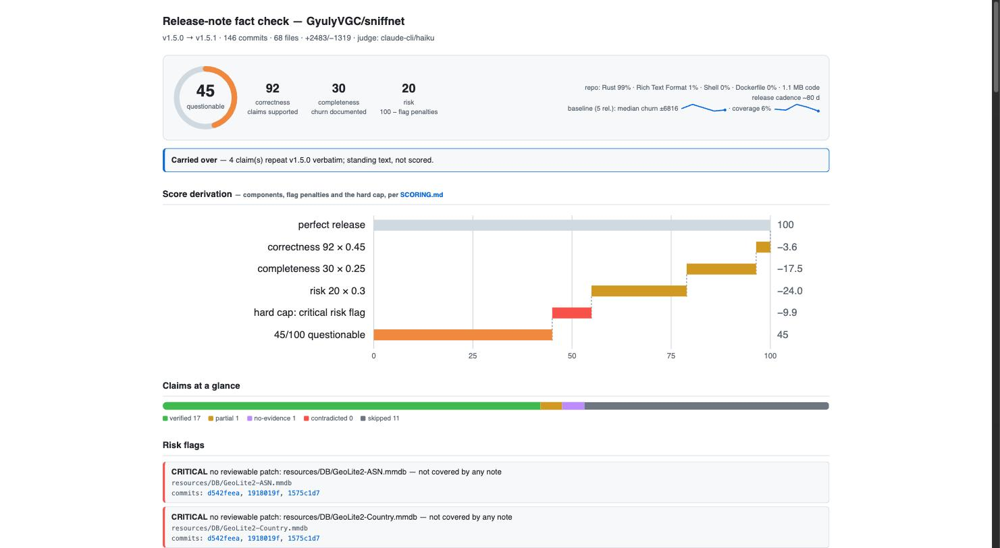
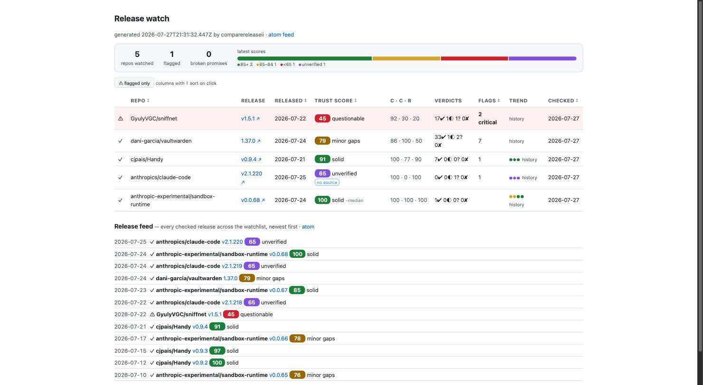

# comparereleaseii

[](https://github.com/bmmmm/comparereleaseii/actions/workflows/ci.yml)
[](https://github.com/bmmmm/comparereleaseii/actions/workflows/check-release-notes.yml)

Fact-check release notes against the actual code diff.

Release notes are claims. This tool takes a release, splits the notes into
atomic claims, and checks each claim against the real diff between the
release and its predecessor — plus the reverse direction: which code changes
are *not* covered by any note (silent changes).

<picture>
  <source media="(prefers-color-scheme: dark)" srcset="docs/assets/report-dark.jpg">
  
</picture>

*A real report ([browse the demo](https://bmmmm.github.io/comparereleaseii/demo/)): 92 % of sniffnet's
claims check out, but two binary databases changed without a note — the
waterfall shows exactly how that turns into 45/100.*

## Quick start

```console
$ gh extension install bmmmm/gh-comparereleaseii
$ gh comparereleaseii restic/restic --tag v0.19.1 --html report.html
19 claims parsed from the notes of v0.19.1; verifying against 38 commits…

comparereleaseii — release-note fact check
restic/restic  v0.19.0 → v0.19.1  (38 commits, 50 files, +826/−113)
judge engine: claude-cli/haiku
…
Summary: 19 claims — 9 verified, 0 partial, 0 no-evidence, 0 contradicted, 10 skipped
Trust score: 90/100 (solid) — correctness 100 · completeness 71 · risk 90

Risk flags:
  ! Undocumented changes in dependencies paths
    go.mod, go.sum
HTML report written to report.html
```

Three ways to run it, the same CLI behind all of them:

- **`gh` extension** (above) — a SHA-pinned wrapper that follows releases via
  `gh extension upgrade`.
- **Source checkout** — `gh repo clone bmmmm/comparereleaseii`, then
  `node src/cli.ts …`. No install, no build step, no runtime dependencies:
  Node ≥ 24 runs the TypeScript directly. For cron jobs:
  `ln -s "$PWD/bin/comparerelease.mjs" ~/.local/bin/comparerelease`.
- **CI** — the repo doubles as a [GitHub Action](#in-ci--the-github-action):
  `uses: bmmmm/comparereleaseii@v0.14.0`, nothing to clone.

**Requirements:** Node ≥ 24, `git` (plus an authenticated
[`gh`](https://cli.github.com) for GitHub repos), and a judge: the
[`claude`](https://code.claude.com) CLI (default), an `ANTHROPIC_API_KEY`, or
any OpenAI-compatible server ([local models](docs/local-models.md)). Without
a judge the tool falls back to its deterministic stages.

`--estimate` previews claims, LLM calls and cost before the first run — the
restic release above is ~3 Haiku calls ≈ $0.01, vaultwarden 1.37.0 (45 claims,
90 files) ~13 calls ≈ $0.07. Re-runs hit the verdict cache and take seconds.

## Usage

```console
$ gh comparereleaseii juanfont/headscale                                # latest release
$ gh comparereleaseii owner/repo --tag v2.0 --notes-file draft.md       # check a draft
$ gh comparereleaseii --local ~/src/myrepo --base v1.2.0 --head v1.3.0  # local clone
$ gh comparereleaseii --repo-url https://git.example.com/team/app.git --tag v1.3.0
```

From a source checkout, read `node src/cli.ts` (or `comparerelease`) for
`gh comparereleaseii` — same arguments, same output. `--help` lists every
option.

| Source | How you name it | Published notes come from | Needs |
|---|---|---|---|
| GitHub | `owner/repo` | the GitHub release | authenticated `gh` |
| Any other forge | `--repo-url <url>` | the forge's release API, else the CHANGELOG section for the tag | `git` |
| A local checkout | `--local <path>` | the CHANGELOG section for the tag | `git` |

`--repo-url` clones (cached, fetched on later runs) and then checks exactly
like `--local`, so Forgejo, Gitea, GitLab, private servers and air-gapped
mirrors all work. The only non-git call is the forge's release list; private
repos take `FORGEJO_TOKEN`/`GITEA_TOKEN` or `GITLAB_TOKEN` from the
environment. `--baseline` and `--history` work here too, computing each past
release's diff from the clone — budget roughly one head-sized fetch per
baseline release, or pass `--baseline 0`. Behind an HTTP proxy, also export
`NODE_USE_ENV_PROXY=1`.

**Reports:** `--md`, `--json`, `--html`. The HTML report is one self-contained
file: trust-score ring, verdict bar, risk flags and a treemap of the diff (tile
size = changed lines, color = documentation status, amber border = sensitive
path).

**Exit codes:**

| Code | Meaning |
|---|---|
| `0` | every claim supported |
| `1` | unsupported or contradicted claims found — the CI gate |
| `2` | usage or data error |

`--fail-on contradicted` fails only on claims the diff contradicts.
`--min-coverage 60` gates the other direction: fail when under 60 % of the
changed lines are covered by the notes — the cheap deterministic gate to adopt
first. Releases that cannot be checked here (docs-only bumps, changelog
mirrors of closed-source products) are labelled **unverified** rather than
failed — see [SCORING.md](SCORING.md#unverified--releases-that-cannot-be-checked-in-this-repo).

## How it works

Each claim runs through an escalation ladder — cheap deterministic checks
first, an LLM judge only for what remains unclear:

1. **Anchors** — PR numbers and commit SHAs are resolved against the release
   range.
2. **Lexical** — code identifiers in the claim are grepped in the changed
   lines. Backticks are the note author's own markup and buy no evidence.
3. **Ranking** — the diff's hunks are ranked against the claim (tf-idf + path
   boost).
4. **LLM judge** — claim + top hunks → `verified` / `partial` / `no-evidence`
   / `contradicted`, citing evidence lines. Release-failing verdicts are
   confirmed by a 3-vote median. Verdicts are cached
   (`$XDG_CACHE_HOME/comparereleaseii`, else `~/.cache/comparereleaseii`,
   mode 0700, keyed by tool version);
   `comparerelease cache stats|gc` manages it, `--no-cache` skips it.

Every run computes an explainable **trust score** (0–100) from correctness,
completeness and risk; contradicted claims or critical flags cap it, so a fake
release cannot average itself back to green. `--baseline <n>` adds the repo's
own release history as an anomaly baseline (unusual size, first-time authors
on sensitive paths, first-ever binaries). Formulas, weights and flags:
[SCORING.md](SCORING.md).

Beyond the score, the report states — informational, never scored:

- **Silent changes** — commits no claim covers, described by what their diff
  touched, not by their own subject line.
- **What shipped** — file categories, changed symbols, config surface
  (env vars, flags, keys) and moved **default values**, marked `⚠` when no
  note names them. Works with `--judge off`.
- **Version pins** — dependency bumps as `(name, from → to)`; the notes' own
  bump claims are checked against both numbers. First-party pins (same owner,
  or `--component NAME=owner/repo`) get a depth-1 sub-check of the component's
  own release (`--no-expand` turns it off).
- **Promises** — "deprecated, removed in 2.0" is checked against later
  releases and reported kept, broken or still open.
- **Findings** — with a judge, the diff itself is read into typed findings
  (breaking / security / behavior / feature / internal) per audience, without
  ever seeing the notes or commit messages. `--lens operator|integrator|user`
  filters; `--no-findings` turns it off.

Writing notes instead of checking them? `--suggest` drafts a line for each
undocumented high-churn commit, and `gh comparereleaseii guidelines >> AGENTS.md`
hands the rules to your coding agent —
[docs/writing-release-notes.md](docs/writing-release-notes.md).

## Judges

Any OpenAI-compatible server (Ollama, MLX, LM Studio, vLLM, OpenRouter) works
as judge; `--model` is auto-discovered from `/v1/models`. `--calibrate`
measures a judge against a 44-case golden set (rubber-stamping and prompt
injection included) and can rank every model your server offers;
`--escalate auto` hands release-critical verdicts from a local judge to a
stronger engine. Details and numbers: [docs/local-models.md](docs/local-models.md).

## Run it continuously

### On your machine — the release watchdog

`watch setup` takes a bare machine to a scheduled routine in one interactive
command (home directory, judge, launchd/cron file, notify hook). `watch init`
builds the repo list from what your GitHub account follows; other forges join
via `watch add --repo-url`. Then `comparerelease watch --config watch.json`
fact-checks every new release as it appears, writes a dashboard
(`reports/index.html`), per-repo history pages and an Atom feed, and pipes
flagged releases to `--notify <cmd>`. Everything is plain files.
Full guide: [docs/watchdog.md](docs/watchdog.md).

<picture>
  <source media="(prefers-color-scheme: dark)" srcset="docs/assets/watch-index-dark.jpg">
  
</picture>

*Real output of a watch pass over five public repos —
[browse it](https://bmmmm.github.io/comparereleaseii/demo/), reproducible from
[docs/demo/](docs/demo/).*

### In CI — the GitHub Action

Checks a release's notes, writes the report to the step summary, uploads the
HTML report and fails the job by the CLI's exit code:

```yaml
name: check-release-notes
on:
  release:
    types: [published]
permissions:
  contents: read
jobs:
  check:
    runs-on: ubuntu-latest
    steps:
      - uses: bmmmm/comparereleaseii@v0.14.0
        with:
          anthropic-api-key: ${{ secrets.ANTHROPIC_API_KEY }}
```

All inputs: [action.yml](action.yml). `repo-url` gates releases on another
forge, `notes-file` gates a draft before publishing, `comment: true` appends
the verdict to the release body, and `engine: "off"` runs keyless — exactly
how this repo checks its own releases.

## Validation

Real release notes in genuinely different styles:

| Release | Notes style | Score |
|---|---|---|
| headscale v0.29.2 | prose + full sha list | 100 (solid) |
| git-cliff v2.13.0 | Keep a Changelog, conventional commits | 87 (solid) |
| restic v0.19.1 | setext sections, issue anchors, cherry-picks | 82 (minor gaps) |
| vaultwarden 1.37.0 | generated PR list + handwritten security | 79–82 (no majority over five draws) |
| negative control: fabricated notes on the vaultwarden 1.37.0 diff | — | 5 (suspicious), exit 1 |

Judged with `claude-cli/haiku`, `--no-cache`, measured serially; runs with a
load warning or `judge-unavailable` are redrawn, a moving score is drawn three
times and the majority published — or the spread, when there is none. Judged
2026-08-16 (five draws per row), restic redrawn 2026-08-17 for scoring
generation 7; every other row, and generation 8, re-verified bit-identical
under `--judge off`. The five-draw flicker bands: headscale 96–100, restic 86
(zero spread), vaultwarden 79–82 (draws 82, 79, 82, 80, 79), git-cliff 35–88 —
one draw in six ruled a single claim contradicted, and one contradicted claim
caps the score (issue #17). Per-generation re-measurements:
[CHANGELOG.md](CHANGELOG.md).

A fabricated claim from the negative control, caught against the diff:

```
✘ The icon endpoint was removed entirely in this release
  contradicted (0.95) · none+llm · src/api/icons.rs
  The diff shows the routes() function still exists in src/api/icons.rs and
  still registers icon routes via routes![icon_internal] and
  routes![icon_external]. The endpoint registration is intact, directly
  contradicting the claim of complete removal.
```

**Does it catch a release that lies?** `pnpm mutate-notes` falsifies the notes
of real releases and asks whether the detector notices — judge off, no
network. On 111 releases (`test/eval/reference-detection.json`, 2026-08-14):

| Mutation | What it does | Detected |
|---|---|---:|
| `omission` | drops the notes covering a documented high-churn commit | 63/64 |
| `bump-overshoot` | restates a bump as a version the release did not reach | 22/22 |
| `bump-undershoot` | restates it as a version the pin never held | 22/22 |
| `foreign-claim` | plants a claim from a different release of the same repo | 110/110 |
| `backtick-noise` | fabricates a claim padded with two identifiers from the diff | 109/109 |

A run worse than the frozen reference fails; re-freezing is a deliberate
decision.

**What it found in the wild:** 80 releases across 13 repositories —
[docs/corpus.md](docs/corpus.md). Notes are bimodal: 46 of 80 cover ≥ 90 % of
the lines they changed, 15 cover under 25 %. Outright false claims are rare
(12 in 2,911); silence is not.

## Development

```console
$ pnpm install
$ pnpm check   # tsc --noEmit
$ pnpm test    # node:test unit tests
$ pnpm eval    # judge eval against the golden set (needs an engine)
$ pnpm mutate  # do the tests actually guard the rules? (mutates src/)
$ pnpm mutate-notes ~/release-watch/reports   # does the detector catch a lie?
```

[CONTRIBUTING.md](CONTRIBUTING.md) covers the workflow and the stable
contracts, [AGENTS.md](AGENTS.md) is the condensed version for coding agents,
[docs/ARCHITECTURE.md](docs/ARCHITECTURE.md) maps the modules. The isolated
evidence-ranking experiment lives in the
[retrieval lab](docs/retrieval-lab.md).

### Releasing

From a dev machine — no repo secrets, no CI involvement. Write notes into the
CHANGELOG's `Unreleased` section as you go, then:

```console
$ pnpm release:prepare X.Y.Z      # bump + CHANGELOG section + version pins; gates on tests and dogfood
$ node src/cli.ts --calibrate     # judge drift check against the golden set
$ git add -u && git commit -m "Release vX.Y.Z: <short pitch>"
$ pnpm release:publish            # tag, push to every remote, GitHub release
$ gh workflow run bump-pin.yml --repo bmmmm/gh-comparereleaseii   # pin the extension now
```

There is no npm publish — the tag *is* the distribution.

## Contributing

Bug reports, misparsed dialects and wrong verdicts are welcome via the
[issue forms](https://github.com/bmmmm/comparereleaseii/issues/new/choose).
`--add-golden` turns a wrong verdict into a ready-made regression case:

```console
$ comparerelease --add-golden report.json 12 no-evidence "the diff only renames a field"
```

Pull requests state their claims and let this tool check them against their
own diff. Vulnerabilities go through [SECURITY.md](SECURITY.md).

## Support

If this tool is useful to you, you can support development at
[ko-fi.com/bmabma](https://ko-fi.com/bmabma).

## License

GPL-3.0-or-later — see [LICENSE](LICENSE).
